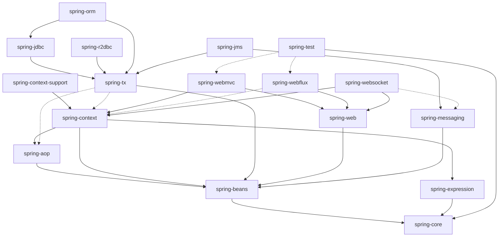

# Spring Framework 源码学习地图

本文依据当前检出的 `settings.gradle`、模块构建脚本和源码整理，共 27 个 Gradle 子项目。
模块名与源码位置以当前分支为准；这是 Spring Framework 仓库，Spring Boot 自动配置与 Spring Data Repository 不在这里。

## 从哪里开始

1. **IoC 主线**：spring-core → spring-beans → spring-context。先理解 BeanDefinition、getBean、refresh。
2. **代理主线**：spring-aop → spring-tx → spring-jdbc。理解自动代理、拦截器链、事务传播和连接绑定。
3. **Servlet Web 主线**：spring-web → spring-webmvc → spring-test。跟踪一次控制器请求及 MockMvc 测试。
4. **响应式主线**：spring-web → spring-webflux，结合 spring-r2dbc 与响应式事务。先掌握 Reactor，再读异步链。
5. **按需扩展**：消息、WebSocket、ORM、缓存调度、AspectJ 与 AOT。构建、文档辅助模块最后看。

阅读顺序不是完整依赖顺序。例如 spring-context 已经依赖 spring-aop，但初读 refresh 时可以先跳过代理细节。

## 简化依赖图

箭头 `A → B` 表示 A 依赖 B；实线表示模块脚本中的直接 `api` 依赖，虚线表示可选集成。
为便于阅读省略重复边和辅助模块；完整直接依赖见后面的表格。



MVC 和 WebFlux 是两条 Web 技术栈；WebFlux 不依赖 MVC。事务抽象不依赖具体 JDBC 实现；JDBC 和 R2DBC 各自实现事务管理。

## 所有模块与直接依赖

`api` 是对消费者暴露的依赖；`optional` 为相应集成功能服务，不会像普通 API 依赖那样自动传递。
本表列出模块脚本静态声明的生产依赖，不包含第三方库、测试依赖、测试夹具和根构建注入的约束。

| 模块 | 作用 | API / 实现依赖 | 可选模块 |
| --- | --- | --- | --- |
| [spring-aop](spring-aop/MODULE-GUIDE.md) | 实现基于代理的面向切面编程，为事务、异步等提供方法拦截能力。 | spring-beans, spring-core | 无 |
| [spring-aspects](spring-aspects/MODULE-GUIDE.md) | 提供 AspectJ 切面，支持事务、异步、缓存和 Configurable 等织入场景。 | 无 | spring-aop, spring-beans, spring-context, spring-context-support, spring-orm, spring-tx |
| [spring-beans](spring-beans/MODULE-GUIDE.md) | 实现 Bean 定义、注册、创建、属性填充和依赖注入，是 IoC 容器的核心。 | spring-core | 无 |
| [spring-context](spring-context/MODULE-GUIDE.md) | 在 BeanFactory 上构建应用上下文，整合配置类、组件扫描、事件、国际化、生命周期、缓存、调度等能力。 | spring-aop, spring-beans, spring-core, spring-expression | spring-instrument |
| [spring-context-indexer](spring-context-indexer/MODULE-GUIDE.md) | 通过编译期注解处理生成候选组件索引 META-INF/spring.components，用于理解组件扫描的索引机制。 | 无 | 无 |
| [spring-context-support](spring-context-support/MODULE-GUIDE.md) | 整合缓存、邮件、Quartz、FreeMarker 等可选基础设施。 | spring-beans, spring-context, spring-core | spring-jdbc, spring-tx |
| [spring-core](spring-core/MODULE-GUIDE.md) | 提供资源访问、类型解析、转换、注解合并与 AOT 基础设施，是容器等模块的底座。 | 无 | 无 |
| [spring-core-test](spring-core-test/MODULE-GUIDE.md) | 为框架自身提供动态编译、生成代码测试、运行时提示记录与断言工具。 | spring-core | 无 |
| [spring-expression](spring-expression/MODULE-GUIDE.md) | 实现 Spring Expression Language（SpEL），支持属性访问、方法调用、模板与表达式求值。 | spring-core | 无 |
| [spring-instrument](spring-instrument/MODULE-GUIDE.md) | 提供 Java Agent 入口，保存 JVM Instrumentation，供加载期织入等能力使用。 | 无 | 无 |
| [spring-jdbc](spring-jdbc/MODULE-GUIDE.md) | 封装 JDBC 资源管理、SQL 执行、结果映射和异常转换，并实现 JDBC 事务。 | spring-beans, spring-core, spring-tx | spring-context |
| [spring-jms](spring-jms/MODULE-GUIDE.md) | 整合 Jakarta JMS，简化消息收发、监听容器、注解端点与事务协作。 | spring-beans, spring-core, spring-messaging, spring-tx | spring-aop, spring-context, spring-oxm |
| [spring-messaging](spring-messaging/MODULE-GUIDE.md) | 提供消息、通道、处理器和方法调用抽象，并支持 STOMP、RSocket 等消息模型。 | spring-beans, spring-core | spring-context, spring-oxm |
| [spring-orm](spring-orm/MODULE-GUIDE.md) | 整合 JPA/Hibernate，管理持久化工厂、EntityManager 生命周期、事务与异常转换。 | spring-beans, spring-core, spring-jdbc, spring-tx | spring-aop, spring-context, spring-web |
| [spring-oxm](spring-oxm/MODULE-GUIDE.md) | 统一对象与 XML 之间的编组、解组接口，并适配 JAXB 等实现。 | spring-beans, spring-core | 无 |
| [spring-r2dbc](spring-r2dbc/MODULE-GUIDE.md) | 基于 R2DBC 提供响应式数据库访问和事务集成。 | spring-beans, spring-core, spring-tx | 无 |
| [spring-test](spring-test/MODULE-GUIDE.md) | 提供面向使用者的 Spring 集成测试工具，包含测试上下文、事务测试、MockMvc 和 WebTestClient。 | spring-core | spring-aop, spring-beans, spring-context, spring-jdbc, spring-orm, spring-tx, spring-web, spring-webflux, spring-webmvc, spring-websocket |
| [spring-tx](spring-tx/MODULE-GUIDE.md) | 定义统一事务抽象，实现命令式和响应式事务流程、事务属性解析与声明式事务拦截。 | spring-beans, spring-core | spring-aop, spring-context |
| [spring-web](spring-web/MODULE-GUIDE.md) | 提供 HTTP、Web 应用上下文、Servlet 基础设施、客户端、消息转换与绑定支持，是 MVC 和 WebFlux 的公共基础。 | spring-beans, spring-core | spring-aop, spring-context, spring-oxm |
| [spring-webflux](spring-webflux/MODULE-GUIDE.md) | 实现基于 Reactive Streams 的响应式 Web 框架，提供注解控制器、函数式端点和 WebClient。 | spring-beans, spring-core, spring-web | spring-context, spring-context-support |
| [spring-webmvc](spring-webmvc/MODULE-GUIDE.md) | 实现 Servlet 技术栈的 Spring MVC，包括请求分发、控制器调用、参数绑定与视图渲染。 | spring-aop, spring-beans, spring-context, spring-core, spring-expression, spring-web | spring-context-support, spring-oxm |
| [spring-websocket](spring-websocket/MODULE-GUIDE.md) | 提供 WebSocket 会话、握手与处理器，并整合 SockJS 和 STOMP 消息代理。 | spring-context, spring-core, spring-web | spring-messaging, spring-webmvc |
| [framework-api](framework-api/MODULE-GUIDE.md) | 聚合各 Spring 模块的 Java/Kotlin API 文档，用于生成统一 API 站点。 | 聚合所有 spring-* 的 API 文档 | 无 |
| [framework-bom](framework-bom/MODULE-GUIDE.md) | 发布 spring-framework-bom，通过依赖约束统一 Spring 模块版本。 | 约束所有 spring-* 版本 | 无 |
| [framework-docs](framework-docs/MODULE-GUIDE.md) | 维护参考文档、可编译的 Java/Kotlin 示例以及文档站点构建。 | spring-aspects, spring-context, spring-context-support, spring-core-test, spring-jdbc, spring-jms, spring-test, spring-web, spring-webflux, spring-webmvc, spring-websocket | 无 |
| [framework-platform](framework-platform/MODULE-GUIDE.md) | 集中管理本仓库构建和测试使用的第三方依赖版本与 BOM。 | 第三方 BOM 与版本约束 | 无 |
| [integration-tests](integration-tests/MODULE-GUIDE.md) | 验证多个模块组合后的行为，包括容器、代理、事务、持久化等跨模块场景。 | 仅测试依赖 | 无 |

## 三条源码追踪路线

### 容器启动与依赖注入

```text
AnnotationConfigApplicationContext
  → AbstractApplicationContext.refresh
  → invokeBeanFactoryPostProcessors（处理配置类、注册定义）
  → registerBeanPostProcessors（注册实例生命周期扩展）
  → finishBeanFactoryInitialization（初始化非懒加载单例）
  → DefaultListableBeanFactory.preInstantiateSingletons
  → AbstractBeanFactory.doGetBean
  → AbstractAutowireCapableBeanFactory.doCreateBean
  → populateBean / initializeBean
```

这张调用路线省略中间层，不是每个方法之间都直接调用。留意 FactoryBean、懒加载与作用域会改变具体路径。

### 事务方法调用

```text
自动代理创建 → JDK/CGLIB 代理
  → ReflectiveMethodInvocation.proceed
  → TransactionInterceptor.invoke
  → TransactionAspectSupport.invokeWithinTransaction
  → PlatformTransactionManager.getTransaction
  → 业务方法
  → commit / rollback
```

先看命令式事务；响应式事务使用 Reactor 上下文关联资源，需要另读响应式分支。

### MVC 请求处理

```text
DispatcherServlet.doDispatch
  → HandlerMapping 查找处理器
  → HandlerAdapter 调用处理器
  → 参数解析与数据绑定
  → 控制器方法
  → 返回值处理（消息转换或视图渲染）
```

## 构建与辅助目录

| 目录或文件 | 作用 |
| --- | --- |
| [buildSrc](buildSrc/MODULE-GUIDE.md) | 构建插件、代码规范、工具链和可选依赖机制 |
| [gradle](gradle/MODULE-GUIDE.md) | 共享 Gradle 脚本、Wrapper 与发布配置 |
| src | 仓库级 Checkstyle 等配置 |
| build.gradle / settings.gradle | 项目统一配置与模块清单 |
| build、各模块 build | 生成产物和报告；不作为源码学习入口 |

根构建会为配置的 classpath 引入 `framework-platform`（见 `build.gradle` 中的 dependencyManagement），这是构建版本管理关系，不画成生产模块运行依赖。

## 如何结合测试学习

- 在 IDE 对核心方法下断点，优先运行对应模块已有的小型测试；用测试验证自己的理解。
- 例：`./gradlew :spring-beans:test --tests "org.springframework.beans.factory.DefaultListableBeanFactoryTests"`。
- 修改源码后按仓库约定运行相应模块的 `check`。
- 本地编译要求以 `.sdkmanrc` 和工具链配置为准，当前默认工具链为 JDK 25，基础产物目标为 Java 17。
- 先前使用的 `./gradlew build -x test -x javadoc` 只表示跳过测试和文档后的构建成功，不能代替验证。
